<picture>
  <source media="(prefers-color-scheme: dark)" srcset="assets/banner-dark.svg">
  <source media="(prefers-color-scheme: light)" srcset="assets/banner-light.svg">
  
</picture>

Hago aplicaciones de gestión a medida para empresas, desde la base de datos hasta el servidor donde se ejecutan.

### Lo que construyo

- Aplicaciones web para varias empresas a la vez, con su propia base de datos y su propio dominio, con Laravel y Filament.
- Servicios y APIs con .NET.
- La puesta en producción: Docker en servidor propio, HTTPS, copias de seguridad y despliegue automático desde GitHub.

### Con qué trabajo

**Backend:** PHP, Laravel, Filament, C#, .NET
**Datos:** MariaDB, MySQL, Redis
**Interfaz:** Livewire, Alpine.js, Tailwind CSS
**Servidores:** Linux, Docker, Coolify, GitHub Actions

### Actividad

<picture>
  <source media="(prefers-color-scheme: dark)" srcset="https://raw.githubusercontent.com/CoBaX756/CoBaX756/output/snake-dark.svg">
  <source media="(prefers-color-scheme: light)" srcset="https://raw.githubusercontent.com/CoBaX756/CoBaX756/output/snake.svg">
  
</picture>
