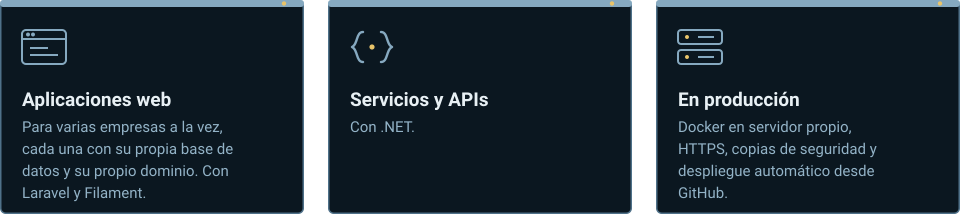

<picture>
  <source media="(prefers-color-scheme: dark)" srcset="assets/banner-dark.svg">
  <source media="(prefers-color-scheme: light)" srcset="assets/banner-light.svg">
  
</picture>

<picture>
  <source media="(prefers-color-scheme: dark)" srcset="assets/presentacion-dark.svg">
  <source media="(prefers-color-scheme: light)" srcset="assets/presentacion-light.svg">
  
</picture>

<picture>
  <source media="(prefers-color-scheme: dark)" srcset="assets/terminal-dark.svg">
  <source media="(prefers-color-scheme: light)" srcset="assets/terminal-light.svg">
  
</picture>

<picture>
  <source media="(prefers-color-scheme: dark)" srcset="assets/construyo-dark.svg">
  <source media="(prefers-color-scheme: light)" srcset="assets/construyo-light.svg">
  
</picture>

<picture>
  <source media="(prefers-color-scheme: dark)" srcset="assets/tecnologias-dark.svg">
  <source media="(prefers-color-scheme: light)" srcset="assets/tecnologias-light.svg">
  
</picture>

<picture>
  <source media="(prefers-color-scheme: dark)" srcset="https://raw.githubusercontent.com/CoBaX756/CoBaX756/output/snake-card-dark.svg">
  <source media="(prefers-color-scheme: light)" srcset="https://raw.githubusercontent.com/CoBaX756/CoBaX756/output/snake-card-light.svg">
  
</picture>
